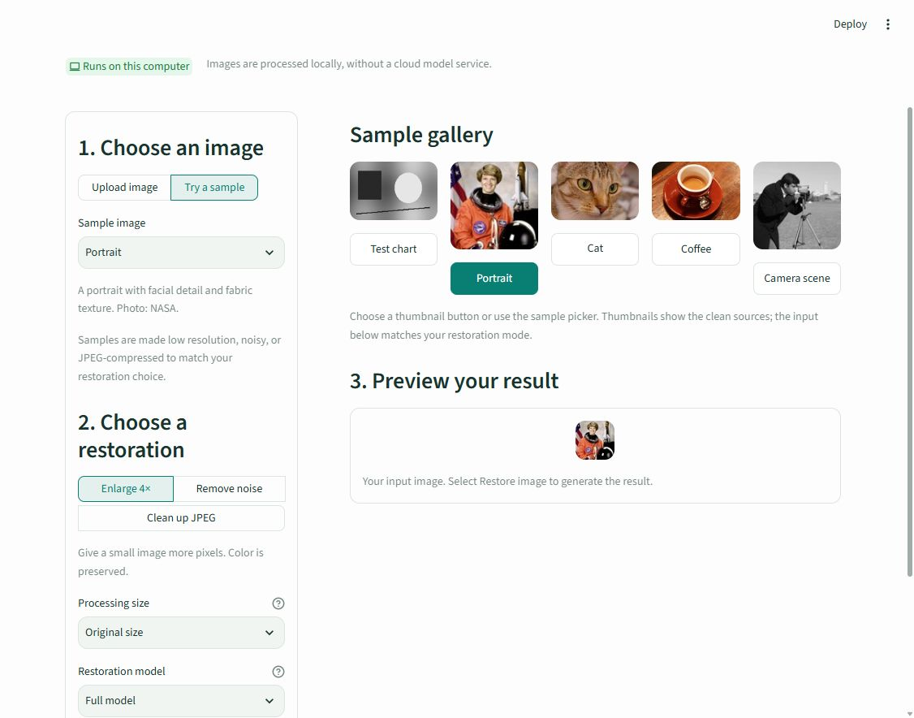

# ShiftLUT Image Restoration

A local image restoration app based on **ShiftLUT: Spatial Shift Enhanced Look-Up Tables for Efficient Image Restoration**. Upload a photo or choose a bundled sample, restore it on CPU, compare before and after, and download a PNG.

[](https://arxiv.org/abs/2603.00906) [](https://cvpr.thecvf.com/)

---

## Features

- **Enlarge 4×:** four times the input width and height; color is preserved.
- **Remove noise:** the supplied sigma-15 model; grayscale output.
- **Clean up JPEG:** the supplied quality-10 model; grayscale output.
- Five sample choices: test chart, portrait, cat, coffee, and camera scene.
- Side-by-side previews, a wipe comparison slider, and PNG downloads.
- Included lookup tables and trained CNN checkpoints, plus the original training and evaluation scripts.



## Install and run

Use **Python 3.12**, 64-bit. A GPU, training run, and separate model download are not required for the app. Install Git if you want to clone; alternatively, download and extract the repository ZIP from GitHub.

### Windows (PowerShell)

```powershell
git clone https://github.com/goutamagrawall/ShiftLUT-image-restoration-.git
cd ShiftLUT-image-restoration-
py -3.12 -m venv .venv
.\.venv\Scripts\python.exe -m pip install --upgrade pip
.\.venv\Scripts\python.exe -m pip install -r requirements-ui.txt
.\.venv\Scripts\python.exe -m streamlit run app.py --server.port 8501
```

If `py` is unavailable and `python --version` reports Python 3.12, use `python -m venv .venv` instead.

### macOS / Linux

```bash
git clone https://github.com/goutamagrawall/ShiftLUT-image-restoration-.git
cd ShiftLUT-image-restoration-
python3.12 -m venv .venv
.venv/bin/python -m pip install --upgrade pip
.venv/bin/python -m pip install -r requirements-ui.txt
.venv/bin/python -m streamlit run app.py --server.port 8501
```

The pinned CPU requirements were tested on Windows. If your platform has no matching `torch` CPU wheel, install `requirements.txt` and `streamlit==1.66.1` instead of `requirements-ui.txt` using a Python environment supported by those packages.

Open **[http://localhost:8501](http://localhost:8501)**. Keep the terminal open while using the app. Press **Ctrl+C** to stop it. To start it later, change into the project folder and run the final Streamlit command again. On Windows, `start_ui.ps1` is also available after installation if your PowerShell policy allows local scripts; environment activation is optional.

After changing Python files, stop and restart the server. File watching is disabled in the included configuration, so restarting ensures updated helper modules load.

## Use the interface

1. Choose **Upload image**, or **Try a sample** and select a gallery button or dropdown option.
2. Choose **Enlarge 4×**, **Remove noise**, or **Clean up JPEG**.
3. Leave **Processing size → Original size** selected to process all uploaded pixels, within the 1-megapixel limit. For enlargement, choose a model: Smallest, Balanced, or Full model.
4. Check the displayed uploaded, processing, and output dimensions, then click **Restore image**.
5. Compare the previews and click **Download restored image**.

**Sizing matters:** 256 px and 512 px preview settings downsize larger uploads *before* restoration and reduce the downloaded output dimensions too. A 300 × 150 image processed at Original size produces a 1200 × 600 enlargement. On-screen previews fit the available space; the download keeps the stated output size.

Uploads may be PNG, JPEG, WebP, or BMP, up to 20 MB and 40 million decoded pixels. Processing supports up to 1,048,576 input pixels. Larger photos require an explicit preview size; the interface warns when resizing will occur. Samples are deliberately downsampled, made noisy, or JPEG-compressed to match the selected task. Gallery thumbnails show clean sources.

This project restores images; it does not extract text through OCR. It is not a dedicated face restoration or general deblurring model. The denoising and JPEG models target their supplied training settings, so results depend on the input.

Images are processed locally. Uploads and results stay in the running session's memory unless downloaded; restarting or refreshing can clear a result. The included server configuration binds to the local computer.

## Try a single image without training

On Windows, run these commands from the project folder:

```powershell
.\.venv\Scripts\python.exe restore.py --task sr --input "photo.jpg" --output "outputs/photo_4x.png"
.\.venv\Scripts\python.exe restore.py --task denoising --input "noisy.png" --output "outputs/denoised.png"
.\.venv\Scripts\python.exe restore.py --task deblocking --input "compressed.jpg" --output "outputs/cleaned.png"
.\.venv\Scripts\python.exe demo.py
```

On macOS/Linux, replace `.\.venv\Scripts\python.exe` with `.venv/bin/python`. For command-line-only use, install `requirements-cpu.txt` instead of `requirements-ui.txt`. The command-line runner does not resize inputs automatically; start with a small image. Output files are PNGs, and existing outputs require `--overwrite`.

See [MANUAL_TESTING.md](MANUAL_TESTING.md) for model options, quality measurements, and troubleshooting.

## Tests

```powershell
.\.venv\Scripts\python.exe -m unittest discover -s tests -v
```

Use `.venv/bin/python` on macOS/Linux. The tests cover the sample gallery, every sample/task combination, real inference through all three restoration tasks, exact 4× output dimensions, upload validation, resizing warnings, and clearing stale results.

## Original research workflow

The following scripts are retained from the research project. They need dataset paths, model paths, and distributed GPU settings configured before use. Install `requirements-research.txt` for their additional dependencies. The app above uses the included LUTs directly and does not require these steps.

## Step 1: Train the CNN Backbone

```bash
cd Net_train/[task_type]

# Stage 1: Train the network with offset prediction module
bash train_stage1.sh

# Evaluate the Stage 1 model and collect predicted offsets from LSS
python eval_offset.py

# Stage 2: Train the network with fixed offset
bash train_stage2.sh

# (Optional) Evaluate the Stage 2 model
python eval.py
```

---

## Step 2: Convert CNN to LUT

```bash
python net2LUT.py
```

This script converts a trained CNN model into a set of LUTs for efficient inference.

---

## Step 3: Evaluate LUT Performance

```bash
cd LUT_test/[task_type]
python eval_LUT.py
```

This runs the final evaluation using the converted LUTs.

---

> 🔁 Replace `[task_type]` with one of: `sr`, `denoising`, or `deblocking`.

---

## Project Structure

```text
ShiftLUT/
├── Net_train/
│   ├── sr/              # Super-resolution training code
│   ├── denoising/       # Denoising training code
│   └── deblocking/      # Deblocking training code
│
├── models/              # Trained CNN models
├── net2LUT.py           # Convert trained network to LUT
├── app.py               # Streamlit upload and sample interface
├── ui_utils.py          # Image preparation and sample helpers
├── restore.py           # Single-image CPU / optional CUDA runner
├── demo.py              # Generated examples for all three tasks
├── assets/              # Bundled sample photos and credits
├── tests/               # Automated interface and image checks
├── requirements-ui.txt  # App dependencies (includes CPU inference)
│
├── LUT_test/
│   ├── sr/              # Super-resolution LUT evaluation
│   ├── denoising/       # Denoising LUT evaluation
│   └── deblocking/      # Deblocking LUT evaluation
```

# Citation

The research code, trained models, and lookup tables are credited to the ShiftLUT authors. This repository adds the local interface, sample gallery, inference helpers, and usage documentation. If you use the research work, cite:

```bibtex
@inproceedings{zeng2026shiftlut,
  title={ShiftLUT: Spatial Shift Enhanced Look-Up Tables for Efficient Image Restoration},
  author={Zeng, Xiaolong and Yu, Yitong and Xiong, Shiyao and Hao, Jinhua and Sun, Ming and Zhou, Chao and Wang, Bin},
  booktitle={Proceedings of the IEEE/CVF Conference on Computer Vision and Pattern Recognition (CVPR)},
  year={2026},
  url={https://arxiv.org/abs/2603.00906}
}
```

## Acknowledgement

Sample photographs and their credits are documented in [assets/samples/README.md](assets/samples/README.md). The supplied research download did not include a top-level license file; no new blanket license is assigned to the upstream code or models here.
This work is based on the following works, thank the authors a lot.

[SR-LUT](https://github.com/yhjo09/SR-LUT)

[MuLUT](https://github.com/ddlee-cn/MuLUT/tree/main)

[TinyLUT](https://github.com/Jonas-KD/TinyLUT)
